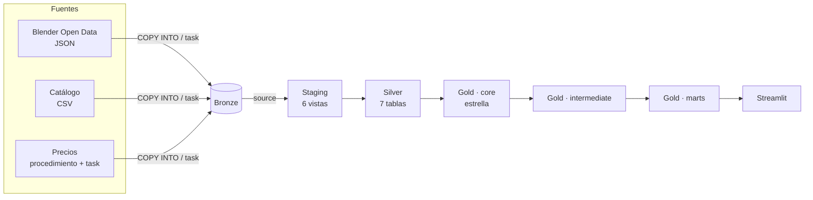

# SiliconROI

**¿Qué componente de PC rinde más por cada euro?**
Data warehouse en **Snowflake + dbt** que cruza benchmarks reales de Blender Open Data, el catálogo de fabricante de CPUs, GPUs y RAM, y precios diarios de cinco tiendas para responder a tres preguntas:

| Pregunta | Mart de Gold |
|---|---|
| ¿Qué componente rinde más por cada euro? | `agg_value_ranking` |
| Con mi trabajo y mi presupuesto, ¿qué equipo me compro? | `agg_profile_recommendations` |
| ¿Compro ahora o espero? | `agg_price_evolution` |

Las tres se consultan desde una app de **Streamlit in Snowflake** que solo lee esos marts.

> Proyecto final del curso de Data Engineering · Cívica · noviembre de 2026

---

## Arquitectura



| Capa | Base de datos | Qué hace | Materialización |
|---|---|---|---|
| Bronze | `SILICONROI_<ENV>_BRONZE_DB` | El dato tal como llega. Solo lo escribe la ingesta; dbt lo lee con `source()` | — |
| Staging | `SILICONROI_<ENV>_SILVER_DB` | Renombra, tipa y extrae campos del JSON. 1:1 con Bronze | view |
| Silver | `SILICONROI_<ENV>_SILVER_DB` | Limpia, cruza fuentes y desduplica | table / incremental |
| Gold · core | `SILICONROI_<ENV>_GOLD_DB` | Modelo en estrella: hechos y dimensiones | table / incremental |
| Gold · intermediate | `SILICONROI_<ENV>_GOLD_DB` | Cálculos reutilizables por varios marts | view |
| Gold · marts | `SILICONROI_<ENV>_GOLD_DB` | Una tabla por caso de uso. Lo único que lee la app | table |

DEV y PRO tienen las mismas capas. El código es el mismo; las variables de entorno `DBT_BRONZE_DB`, `DBT_SILVER_DB` y `DBT_GOLD_DB` deciden dónde escribe cada uno.

### Convención de nombres

`stg_` staging · `slv_` Silver · `dim_` / `fct_` modelo en estrella · `int_` intermedios · `agg_` marts · `snp_` snapshots.
El doble guion bajo separa la fuente del contenido: `slv_precios__daily_prices`.

---

## Fuentes

| Fuente | Volumen | Cómo llega |
|---|---|---|
| **Blender Open Data** | 437.638 envíos reales · 1.048.293 escenas | JSON en una columna `VARIANT`, cargado con stage + file format + `COPY INTO` |
| **Catálogo** | 116 productos: 50 CPUs, 49 GPUs, 17 kits de RAM | CSV de fichas de fabricante, con historial en snapshots SCD2 |
| **Precios** | 580 precios al día (5 tiendas × 116 productos) desde el 01/11/2025 | Procedimiento en Snowflake Scripting lanzado por una task cada noche, calibrado con precios reales |

---

## Modelo de datos (Gold · core)

Constelación de hechos: dos tablas de hechos que comparten dimensiones. Todas las relaciones son 1:N (dimensión → hecho).

- `fct_daily_prices` — un precio por día, tienda y producto → `dim_date`, `dim_products`, `dim_stores`. **Incremental.**
- `fct_benchmark_results` — un resultado de Blender por producto → `dim_products`.
- `dim_products` — una sola dimensión para CPUs, GPUs y RAM (clave sustituta).
- `dim_stores`, `dim_date` (calendario con `dbt_utils.date_spine`).

---

## Piezas de dbt

| Pieza | Qué hay en el proyecto |
|---|---|
| **Modelos** | 23: 6 staging, 7 Silver, 10 Gold |
| **Incrementales (merge)** | `slv_precios__daily_prices` y `fct_daily_prices` (filtro por `loaded_at`, clave `price_id`) · `slv_blender_opendata__benchmark_runs` (ventana de 7 días sobre `created_at`, clave `run_id`) |
| **Snapshots SCD2** | `snp_catalogo__cpus`, `snp_catalogo__gpus`, `snp_catalogo__ram_kits` (estrategia `check`, `hard_deletes: invalidate`) |
| **Seeds** | `tiendas`, `perfiles`, `plataformas`, `mapeo_dispositivos_blender` |
| **Tests** | Más de 100 genéricos (`unique`, `not_null`, `relationships`, `accepted_values`, `dbt_utils`) · 2 singulares (`assert_benchmark_runs_completo`, `assert_recomendaciones_validas`) · 1 unit test (`test_rendimiento_por_euro`) |
| **Macros** | `clean_device_name`, `extract_number`, `usd_to_eur`, `generate_schema_name` |
| **Hook** | `on-run-end` → `log_run_summary`: resumen de cada ejecución con las filas de los incrementales |
| **Freshness** | Precios: aviso a las 24 h, error a las 48 h |
| **Grants** | El rol de la app (`SILICONROI_REPORTING_ROLE`) solo puede leer los marts |

Las decisiones de diseño están comentadas en la cabecera de cada modelo y en los YAML de cada carpeta.

---

## Estructura del repositorio

```
models/
  staging/     blender_opendata · catalogo · precios
  silver/      blender_opendata · catalogo · precios
  gold/        core · intermediate · marts
snapshots/     historial del catálogo
seeds/         reglas de negocio en CSV
macros/        macros reutilizables y hooks/
tests/         tests singulares
dbt_project.yml · packages.yml
```

---

## Ejecución

Paquetes: `dbt_utils` (`dbt deps`).

```bash
dbt deps
dbt seed
dbt snapshot
dbt build                 # modelos + tests en orden
dbt build --full-refresh  # reconstruye también los incrementales
```

### Jobs en dbt Platform

| Job | Entorno | Cuándo | Qué hace |
|---|---|---|---|
| Carga diaria DEV | DEV | Cada noche, 23:30 (hora de Madrid) | `source freshness` + `dbt build` |
| Carga diaria | PRO | Cuando DEV termina con éxito | `source freshness` + `dbt build` |
| Reconstrucción completa | PRO | Manual | `dbt build --full-refresh` |
| Demo · snapshots e incrementales | PRO | Manual | `dbt snapshot` + build de lo que cuelga de los incrementales |

A PRO solo se llega por `main` y jobs: rama `dev` → pull request → `main`.

> Tras la entrega (25/11/2026), la task de precios de Snowflake y los jobs programados quedan pausados.

---

## Stack

Snowflake (warehouse XSMALL con `auto_suspend` de 60 s, stages, `COPY INTO`, `VARIANT` + `LATERAL FLATTEN`, Snowflake Scripting, tasks, zero-copy clone, Time Travel, RBAC, Streamlit in Snowflake) · dbt Platform (Fusion) · GitHub.